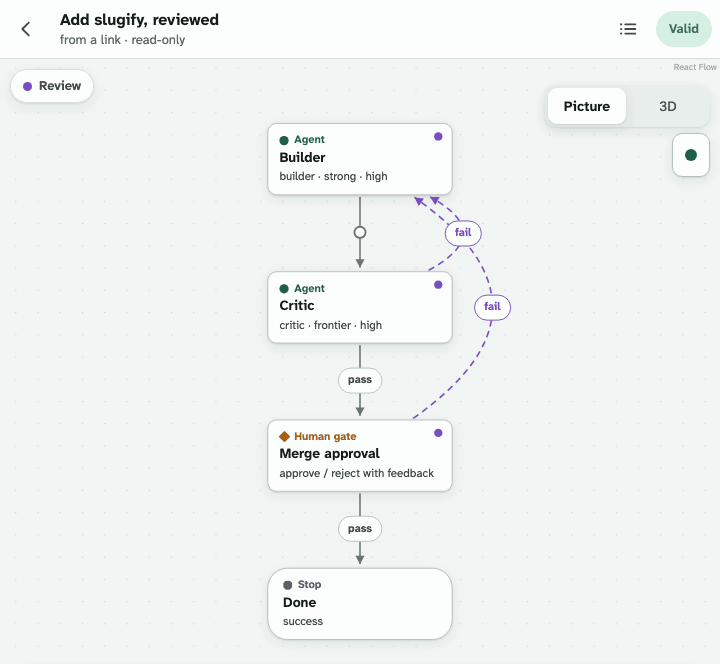

# grooph 💮



[Website](https://ryanjosephkamp.github.io/grooph/) · [Docs](https://ryanjosephkamp.github.io/grooph/docs/) · [Report a bug or suggest a feature](https://github.com/ryanjosephkamp/grooph/issues)

**Lightweight workflow diagrams, in 2D and 3D.** Draw who does the work, who checks it, where a person decides, and when it stops. Draw it yourself, ask an AI agent to draw it, or both: a diagram is one small JSON file, so a person and an agent can take turns on it. grooph checks it and draws it, and the app's **Copy link**, `grooph share`, or the agent gives you a link that opens it in the app on any device.

grooph never runs an agent and never calls a model, and your diagrams stay on your device.

**Open the app:** [ryanjosephkamp.github.io/grooph](https://ryanjosephkamp.github.io/grooph/). It needs no account, works on a phone's screen, and opens offline once it has been opened online.

## Quickstart

You need Node 22 or later. This makes a diagram from a template, checks it, draws it flat and in 3D, and prints a link to it:

```bash
npm install --global grooph
grooph template use grind-loop --name "Fix the flaky test" --set task="Make the checkout test pass ten times in a row." --set test-command="pnpm test checkout" --out flaky.grooph.json
grooph validate flaky.grooph.json
grooph image flaky.grooph.json --out flaky.png
grooph image flaky.grooph.json --view stairs --out flaky-3d.png
grooph share flaky.grooph.json
```

## Ask your agent

From a clone, after a build, `scripts/install-local.sh` links `grooph` into `~/.local/bin` and the `grooph-design` skill into `~/.claude/skills/`:

```bash
git clone https://github.com/ryanjosephkamp/grooph.git && cd grooph
pnpm install && pnpm -r build && scripts/install-local.sh
```

Then describe the work to Claude Code:

```text
/grooph-design a builder and a critic that loop until the checkout tests pass, and ask me before merging
```

The session proposes one to three diagrams, from the templates or from scratch, and gives you a link that compares them side by side on your phone. On your pick it saves that diagram with its picture and a link. It starts no work. The skill also installs as a plugin ([`plugins/grooph/`](plugins/grooph/README.md)), and a chat app can draw with grooph too ([drawing with an agent](docs/agents.md#from-a-chat-app)).

## What is in it

- **An editor** for a phone or a computer: add agents, people's steps, checks, gates, and stops, connect them, and draw loops with their stops. It checks the diagram as you go.
- **2D and 3D.** The flat picture, an outline to read, and five 3D scenes (stairs, panes, spiral, rings, and columns) that you can turn and step through one edge at a time. Six themes, all but one in light and dark.
- **Twenty templates** of agent workflows and **four plans** for people, to start from. [The field guide](docs/field-guide.md) shows them all.
- **Operation maps** for work that spans several sessions, people, and accounts.
- **Ways to keep and share a diagram:** SVG and PNG pictures, a one-file offline page, a link, an embed for any page, Mermaid text (a flowchart, or an agentflow), and `PLAN.md` for people to follow. Mermaid opens in grooph too.
- **A checker** with a stable code for every rule, each with a document that fires it ([rules](docs/rules.md)).

## Experimental

These parts work and are tested, and may change, or go, in a later version.

- **Watching a session.** A hook records which subagents a session starts and stops, and nothing they say, and the app draws it live. The hook appends one line per event and returns nothing to the harness ([watching a session](docs/subagents.md)).
- **Sketch.** Draw a graph by hand with a pen, a finger, or a mouse, in a view of its own beside Picture and 3D, and press Make it a graph. The drawing page is [mermaidify](https://ryanjosephkamp.github.io/mermaidify/)'s, with all its tools, and runs on your device ([sketching it](docs/exports.md#sketching-it)).
- **The MCP server** (`grooph mcp`), which gives an agent grooph's drawing tools as tool calls.
- **The lab**, which compiles a diagram into a prompt package for Claude Code or Codex ([the lab](docs/lab.md)). The records of the experiments below are in [`experiments/`](experiments/README.md).

## What the experiments found

grooph began as a compiler from diagrams to prompt packages. In two paired comparisons, 51 runs on small tasks, the same design written as a plain prompt scored the same as the package, and in the second study it cost less in every run. In the second study, on tasks built so a first pass fails, a reviewer holding evidence the builder could not see made the loop turn, in the package and in the prose alike. A check of the watching hook in 36 runs found no difference in test scores and costs a few cents apart in both directions, and 8 of the 24 sessions with the hook installed mentioned its files. [What the experiments found](docs/experiments.md) has the numbers and links to every record.

## Docs

The same documents as pages: [ryanjosephkamp.github.io/grooph/docs/](https://ryanjosephkamp.github.io/grooph/docs/).

- [Quickstart](docs/quickstart.md) and [drawing with an agent](docs/agents.md)
- [The graph document](docs/graph-ir.md), [operation maps](docs/operation-map.md), and [templates](docs/templates.md)
- [Pictures, views, and sharing](docs/exports.md), with the 3D views and themes
- [Every rule](docs/rules.md) and [every command](docs/cli.md)
- [How grooph is built](docs/ARCHITECTURE.md), [privacy](docs/privacy.md), [security](docs/security.md), [contributing](CONTRIBUTING.md), and [releases](docs/releases.md)

## License and author

MIT licensed; see [LICENSE](LICENSE). The site's Atkinson Hyperlegible Next and Mono fonts retain their SIL Open Font License notices in `apps/web/public/assets/fonts/`.

Created by **[Ryan Kamp](https://github.com/ryanjosephkamp/)**. grooph and all its features are free. Optional support never unlocks features or changes functionality.
