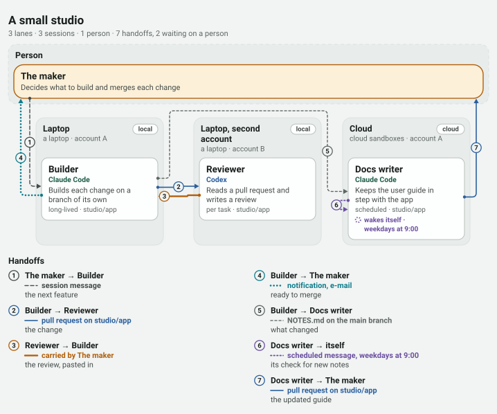
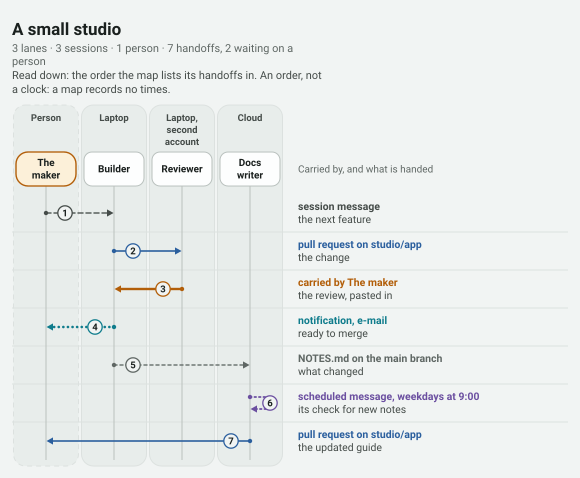
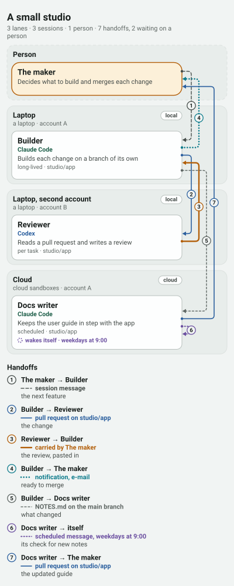

# Operation maps

A **graph** ([`graph-ir.md`](graph-ir.md)) is one harness session and its subagents. An **operation map** is one level up: several sessions, in different harnesses, on different machines and accounts, the people they work with, and how work passes between them. A map is drawn and checked, never compiled or run.

A map is JSON in canonical form (§5), in a file named `<name>.grooph-map.json`. Its JSON Schema, [`packages/core/schema/grooph-map-0.schema.json`](../packages/core/schema/grooph-map-0.schema.json), is generated from the types below; the types win when they disagree.

## 1. Shape

Ids are kebab-case and unique across the map, its lanes, its people, its sessions, and its handoffs.

```ts
type OperationMap = {
  groophMap: 0;          // schema version; a graph carries `grooph` instead
  id: Id;
  name: string;
  version: number;
  asOf?: string;         // the day the map describes, YYYY-MM-DD
  description?: string;
  lanes: Lane[];
  people?: Person[];
  sessions: Session[];
  handoffs: Handoff[];
};
```

### People

Someone a session hands work to or takes work from. A person has no lane, harness, or model. Drawing people is optional: a `person` carrier can name someone who is not drawn.

```ts
type Person = {
  id: Id; name: string;
  role?: string;         // what they do, in one line
  description?: string;
};
```

### Lanes

One machine under one account. Sessions in one lane can see each other's files and can usually message each other; work that crosses lanes needs a carrier both sides can reach.

```ts
type Lane = {
  id: Id; name: string;
  machine: string;       // "a laptop", "cloud sandboxes"
  place?: "local" | "cloud";
  account: string;       // whose sign-in its sessions use
  description?: string;
};
```

### Sessions

One harness session, or a family of like sessions drawn as one.

```ts
type Session = {
  id: Id; name: string;
  lane: Id;
  harness: HarnessId;    // "claude-code", "codex", or any other string
  model?: string;        // free text
  role: string;          // what the session is for, in one line
  lifetime?: "long-lived" | "per-task" | "scheduled";
  count?: number;        // a family: twelve workers are one node with count 12
  graph?: string;        // the graph it runs: a path or URL to a .grooph.json, or "<graph-id>@<version>"
  repo?: string;
  description?: string;
};
```

`graph` is a pointer, not a copy. When it is a web link, such as one from `grooph share <graph>`, the app opens it from the session's details.

### Handoffs

Work passing from one session to another, or between a session and a person, by a named carrier.

```ts
type Handoff = {
  id: Id;
  from: Id; to: Id;      // each a session or a person; the same session twice is a session that wakes itself
  carrier?: Carrier;     // required, by E_HANDOFF_NO_CARRIER
  what?: string;         // what is handed over
  label?: string;
};

type Carrier =
  | { kind: "branch"; repo?: string; ref?: string }
  | { kind: "pull-request"; repo?: string }
  | { kind: "session-message" }                       // typing into a session, or one session messaging another
  | { kind: "scheduled-message"; schedule?: string }  // a routine or timer that puts a prompt into a session
  | { kind: "review-page"; where?: string }           // a published page someone reads
  | { kind: "person"; who?: string }                  // carried by hand; `who` may be left out when the handoff starts at a person
  | { kind: "notification"; where?: string }          // reaches a person with no one carrying it: a push notification, an e-mail
  | { kind: "other"; name?: string };                 // anything else, named
```

## 2. Semantics

A map describes; it does not instruct. Nothing reads a map at run time.

- **A session is the unit of context.** What happens inside it (subagents, loops, brakes) belongs to a graph.
- **A handoff goes one way.** Work that goes out and comes back is two handoffs, often by two carriers.
- **A carrier must be reachable from both ends.** A branch needs a repository both sides can fetch; a session message needs one harness and one account; a person can cross anything, slowly.
- **A handoff that starts at a person waits on that person,** whatever carries it.
- **A `scheduled-message` from a session to itself** is the session waking itself. The picture marks its card.
- **A family (`count`) is one node,** and its handoffs are to and from each member.
- **A map is a snapshot,** dated by `asOf`.

## 3. Validation rules

The output is a list of `{ code, severity, message, at }`, as for a graph. Codes are stable; `E_` is an error and `W_` a warning. Each code has a failing fixture under `fixtures/maps/invalid/<CODE>/`, and the maps under `fixtures/maps/valid/` raise none.

### Structural

These three, and the last two of the next table, mean what they mean for a graph ([`graph-ir.md`](graph-ir.md) §3).

| Code | Rule |
|---|---|
| `E_SCHEMA` | The document is not valid JSON or fails the map schema. The message names the path. |
| `E_DUPLICATE_ID` | An id is used more than once across the map, its lanes, its people, its sessions, and its handoffs. |
| `E_DANGLING_REF` | A session names a lane that does not exist, or a handoff starts or ends at an id that is neither a session nor a person. |

### The map's own

| Code | Rule |
|---|---|
| `E_HANDOFF_NO_CARRIER` | A handoff has no `carrier`, or its carrier does not say what carries it: a `branch` or `pull-request` with no `repo`, a `review-page` with no `where`, an `other` with no `name`, or a `person` with no `who` (unless the handoff starts at a person, who is then the carrier). |
| `W_CARRIER_CANNOT_CROSS` | A carrier that stays inside one harness or one account joins two sessions that are not in the same one: a `session-message` or `scheduled-message` between sessions whose lanes have different accounts or whose harnesses differ, or a `review-page` between sessions whose lanes have different accounts (a published page belongs to the account that published it). Such a handoff is usually carried by a person. |
| `W_NOTIFY_NOT_PERSON` | A `notification` is sent to a session. A notification reaches a person; a session is reached by a message, a branch, or a pull request. |
| `W_SESSION_ISLAND` | A session or a person has no handoff in or out. A person whose only handoffs are to themselves is one too. |
| `W_NO_RETURN` | A session receives a handoff and hands nothing on. |
| `W_GRAPH_UNRESOLVED` | A session's `graph` pointer was looked up and is not a graph document that can be read. Only `grooph validate` looks, and only for a path ending in `.json`, beside the map; a URL or an id is not checked. |
| `W_UNKNOWN_KEY` | A key the schema does not know. It is kept, as in a graph. |
| `W_DOC_TOO_LARGE` | The canonical form is over 24,000 characters, the same limit as a graph's. Draw a family as one session with a `count`, or split the map. |

### What waits on a person

A handoff carried by a `person`, or started by one, is not an issue, but it is where work stalls when that person is away. `grooph validate` lists each one after the issues:

```text
by hand  h-ask  maker → builder: moves only when The maker does it
by hand  h-review  reviewer → builder: moves only when The maker carries it
```

`validate --json` and `shape --json` carry the same list as `byHand`, and the app shows it in the map's details.

## 4. The picture

`mapPicture(map, { theme })` in core draws a map as one SVG, 400 units wide, for a phone:

- the people in a band at the top, then the lanes from top to bottom, each with its machine, account, and place;
- each session a card in its lane: name, harness, model, role, lifetime, repository, and a count on a family;
- each handoff a numbered arc in the right-hand margin, its color and dash set by the carrier (a notification is a line of dots; a `person` carrier is drawn in the gate color);
- below, the handoffs as a numbered list: who to whom, the carrier, and what is handed.

A session that wakes itself says so on its card, with its schedule. Words that do not fit their line wrap; the margin's tracks close up before a card gets narrower than a little over half the lane.

`grooph image <map>` writes it. The app shows it for a map opened from a link or a file, on a screen narrower than 1100 px. With many handoffs the arcs in one margin cross often; the lanes side by side (§4c), the sequence (§4d), and the app's 3D view (§4e) draw the same document other ways. No view changes the document.

## 4a. Where a map goes

| Command | What it does with a map |
|---|---|
| `grooph validate <map> [--json]` | the rules of §3, then what waits on a person |
| `grooph canonicalize <map> [--write]` | canonical form (§5) |
| `grooph shape <map> [--json]` | counts of lanes, sessions, people, and handoffs, and how many wait on a person |
| `grooph image <map> [--out <file>] [--theme <name>]` | the picture as SVG or PNG; `--layout wide` for §4c, `--view sequence` for §4d, `--view stairs` for a still of the map in 3D ([exports.md](exports.md)) |
| `grooph outline <map>` | the map as Markdown |
| `grooph page <map> --out <file.html>` | one offline HTML file with a viewer |
| `grooph share <map>` | a link that opens the map in the app; a map with rule errors still shares, and the view shows them |
| `grooph embed <map>` | one line of HTML that shows the map's picture in another page |

`--theme` takes `light`, `dark`, `auto`, or a theme's name ([`exports.md`](exports.md), "Themes").

In the app, Import on the first screen opens a `.grooph-map.json`, and a link opens a map the same way; the app does not store maps. The switch above the picture offers **Picture**, **Sequence**, and **3D**. From 1100 px wide, Picture has the lanes side by side, with the list of handoffs beside it. Tap a session, a person, or a handoff for what the document says about it; the status in the top bar opens the issues. The map's details offer the document as a download, and Keep a copy.

## 4b. A live map

Experimental: watching sessions may change, or go, in a later version ([`subagents.md`](subagents.md)).

Given what the event hook has seen, the picture marks each session's card: a filled dot and `working · 2 running, 5 done` (subagents), a ring and `waiting`, a gray ring and `last seen … ago` (or `gone quiet`) after half an hour of silence, or a gray dot and `ended`. A session is tied to its events by its id on the command line, not by a field in the map:

```bash
grooph image ops.grooph-map.json --out ops-now.png \
  --events builder=. --events workers=git:origin/worker-a --events workers=git:origin/worker-b
grooph page  ops.grooph-map.json --out ops-now.html --events builder=.
grooph watch --map ops.grooph-map.json --events builder=. --events workers=git:origin/worker-a
```

A source is an events file, a folder, a project, or `git:<ref>`. Sources under one id are summed, so a family of twelve reads `3 of 12 working`. `image` and `page` are snapshots; `watch` serves a page that reads again every two seconds. The map document is never changed: `mapLive(sessions, map)` in core computes the marks, and `mapPicture(map, { live, at })` draws them.

## 4c. Lanes side by side

`mapWide(map)` draws the map for a wide screen: the people across the top, each lane a column in document order, and the list of handoffs below in as many columns as fit. The cards, numbers, and list are the phone picture's own. `grooph image <map> --layout wide` writes it.

No arc runs over a card. An arc runs in the gutters between lanes and, between lanes that are not neighbors, along a deck above them. Tracks nest, short inside long, and the ends on a card are ordered by their tracks, so arcs cross far less than on the phone. The lanes keep the document's order, so the result is not always the fewest crossings.

A card is 168 units wide; three lanes come to about 900 units. Given a `width`, the cards narrow first, to no less than 150 units, then the tracks close up; past that, the picture is wider than the room. A lane's sessions stand in one column, so a full lane is tall, and five or more lanes do not fit most screens.

<a href="../fixtures/maps/pictures/a-small-studio.wide.light.svg"></a>

## 4d. A sequence

`mapSequence(map)` draws the handoffs one to a row: a column for each person and session, and each handoff a numbered arrow from sender to receiver, with the carrier and what is handed beside it in words. People come first, then each lane's sessions inside that lane's box, so an arrow that leaves a box leaves a lane. `grooph image <map> --view sequence` writes it.

**The rows are in the order the map lists its handoffs: an order, not a clock.** A map records no times, and the picture says so under its title.

A column is 62 to 104 units wide, enough for its longest word; on a phone the sequence scrolls sideways in its frame. A column's head is a name only: no role, harness, model, lifetime, repository, machine, account, or live mark.

<a href="../fixtures/maps/pictures/a-small-studio.sequence.light.svg"></a>

## 4e. Three dimensions

**3D** on the switch is in the app only; `grooph image` draws flat pictures.

Each lane is a sheet, and the sheets are stacked, the people's on top. A session is a card standing on its lane's sheet, with its name, harness, model, and count. A handoff is an arc from card to card in its carrier's color and line, with its number. The gap between two sheets says how far apart their lanes are: nearest on one machine, further on two, furthest when one lane is `local` and the other `cloud`.

Drag to turn it, pinch to move in and out, and press **Starting view** to reset it. A wheel scrolls the page until the scene has been picked. With the scene focused, the arrow keys turn it, plus and minus move in and out, and 0 or Home resets it. The cards always face the front. Each card and arc opens its details.

The slider's first stop lights every handoff, then it has one stop per handoff, in the map's order: that handoff and its ends are lit, the others dimmed, and the carrier and what is handed are said below. Play steps one every 2.4 seconds. It is an order, not a clock.

With reduced motion, nothing moves by itself. A browser that cannot draw in 3D, or a device that draws it fewer than 30 times a second while turning, says so and offers the picture and the sequence.

## 5. Canonical form

As a graph's ([`graph-ir.md`](graph-ir.md) §7): two-space indent, LF line endings, one trailing newline, keys in the order §1 lists them, arrays in document order, and unknown keys kept and sorted after the known ones.

## 6. Example

[`fixtures/maps/valid/a-small-studio.grooph-map.json`](../fixtures/maps/valid/a-small-studio.grooph-map.json) is an invented operation: one person who runs a small app, and three sessions in two harnesses, under two accounts. Its picture: [light](../fixtures/maps/pictures/a-small-studio.light.svg), [dark](../fixtures/maps/pictures/a-small-studio.dark.svg).



The maker types the next feature into the Builder, a Claude Code session on a laptop. The Builder opens a pull request, and a Codex session under a second account reviews it. A session message cannot cross two harnesses and two accounts, so the maker pastes the review back in. The Builder e-mails the maker when a change is ready to merge, and writes what changed to `NOTES.md`. A docs session in the cloud wakes itself on weekday mornings, reads the notes, and sends the updated guide as a pull request. Two handoffs wait on the maker.

Smaller samples: [`two-sessions.grooph-map.json`](../fixtures/maps/valid/two-sessions.grooph-map.json), and [`a-person-and-two-sessions.grooph-map.json`](../fixtures/maps/valid/a-person-and-two-sessions.grooph-map.json) ([picture](../fixtures/maps/pictures/a-person-and-two-sessions.light.svg)), the smallest map with a person.

## 7. Deferred

Not in this version: a saved `layout` (every view is laid out automatically, and the reader picks the view); the 3D view on the app's live screen, which draws the flat picture; a graph that points at another graph by reference; tying a map session to its events in the map itself (§4b uses the command line); maps stored in the app's library; and editing a map in the app.
